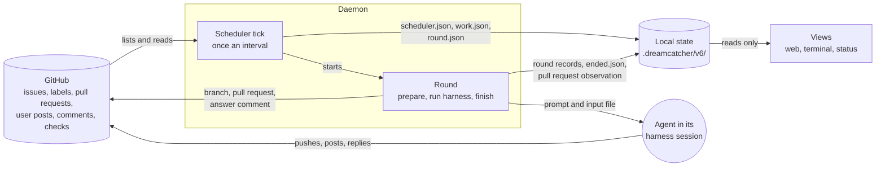
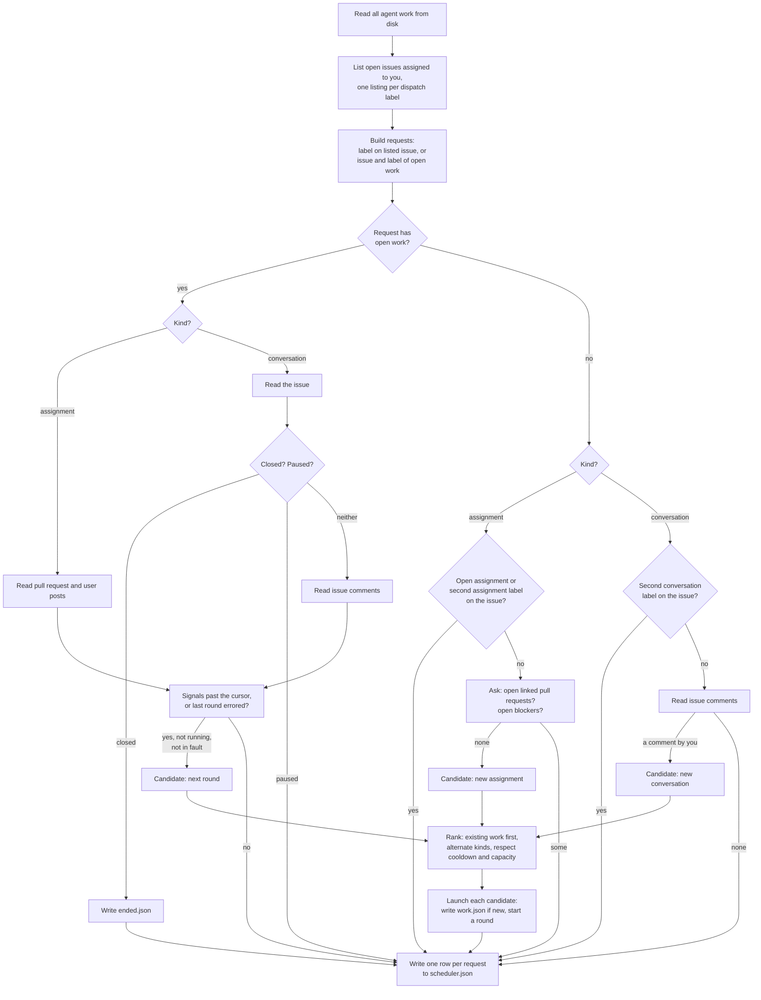
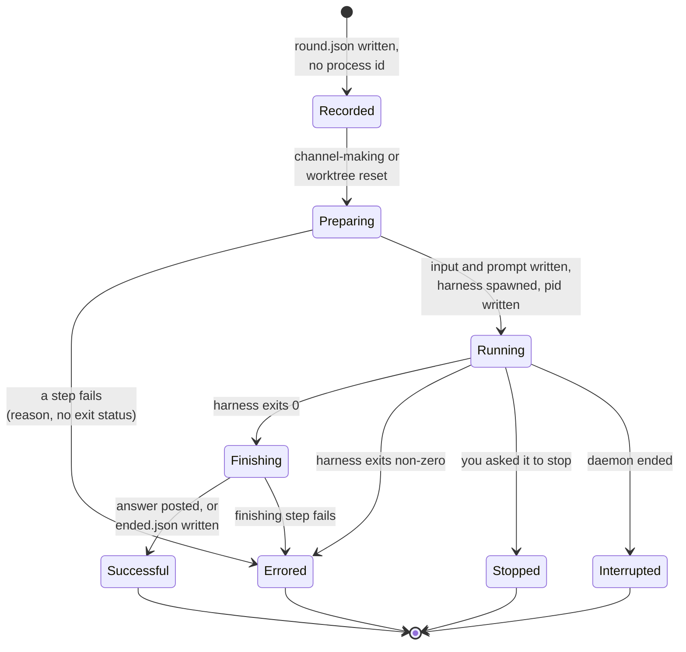
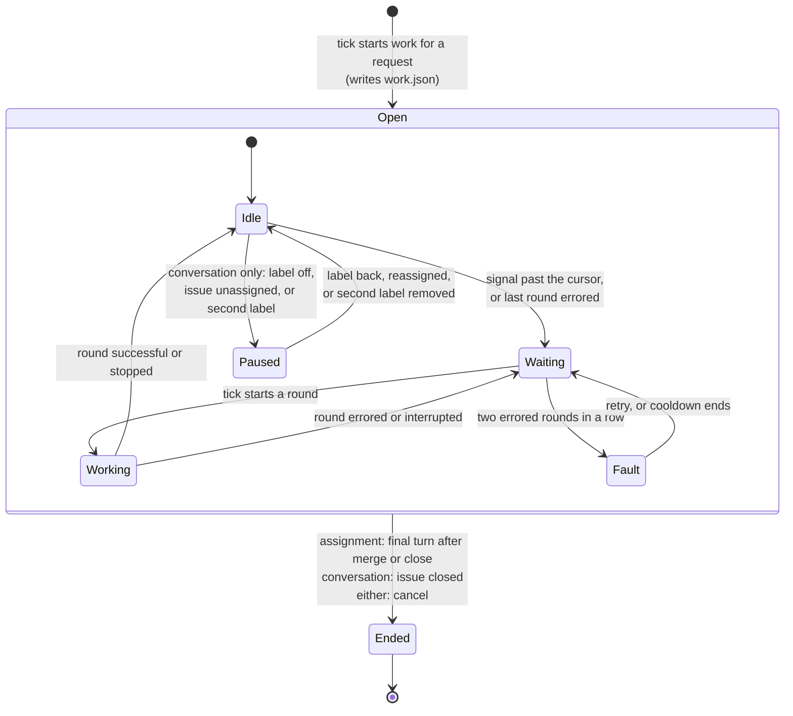

# Design for the state format 6 phase

This design answers the brief in `requirements.md`. The reading guide beside it,
`reading-guide.md`, describes the code as it stands today, and where this
document says "as today" it means that part does not change. Terms are the
ontology's wherever the meaning is unchanged; the few new words are introduced
where they are first needed and listed at the end.

## What we're building

The agent is a collaborator on GitHub. You ask it for help by putting a
**dispatch label** on an issue, and the kind of help is fixed by the label. A
conversation label asks for an **issue conversation**: the agent answers you in
comments on the issue. An assignment label asks for an **agent assignment**: the
agent's answer is a pull request. Both are **agent work**. The repository's
configuration maps each dispatch label to a **dispatch route**, which says which
kind of work the label asks for and, for each **agent harness** that can run it,
a **dispatch recipe** giving the model, the effort and the initial prompt. A
harness is the coding-agent program dreamcatcher runs, Claude Code or Codex, and
a **harness session** is that program's saved conversation, which later rounds
resume so the agent remembers what it did.

A daemon watches the repository. Once an interval it runs a **scheduler tick**:
it reads GitHub and the local state, decides what to start, and starts it. The
agent takes a turn whenever something new for it appears where it talks to you,
and each turn is an **agent round**.

dreamcatcher remembers, per piece of agent work, only three things that GitHub
cannot tell it: where the agent's memory is, which is the harness session; where
it works, which is a Git worktree; and how far the agent has read, which this
design calls the cursor. Everything else is read from GitHub when it is needed.

That is the whole model. The next section walks one assignment through it, so
that every rule stated afterwards has a picture to attach to.

The picture below is the whole data flow. Only the tick talks to GitHub, only
the tick and the rounds write local state, and the views read local state alone.



## One assignment, start to finish

You label issue 20, "Add CSV export", with `dream:smith`, an assignment label,
and assign the issue to yourself, because the tick only considers issues
assigned to you.

The next tick lists the issues under each dispatch label and finds a
**request**: issue 20 with `dream:smith`. A request is one dispatch label on one
issue, and it is the design's name for what a label on an issue has always
meant. No agent work exists for this request yet, so the tick asks GitHub two
questions, the two **start-time questions**: does an open pull request already
claim issue 20, and does an open issue block it? Neither, so the tick writes the
assignment's record, `work/GH20-20261017-091500-assignment/work.json`, naming
the issue, the label, the kind, the title, and the harness settings the route's
recipe gives. From this moment the assignment exists and is open, and the label
no longer matters to it.

The tick then starts round one. It writes `rounds/1/round.json` with the number
and start time and no process id, because nothing has been spawned yet. Round
one's preparation runs: fetch main, add the worktree on a new branch, make an
empty commit, push, open the draft pull request with "Closes #20", and write
`pull-request-observation.json` holding the pull request's number, which is all
that file ever holds. Each step does nothing if its result already exists. Then
the round writes its prompt, the recipe's initial prompt, spawns the harness
with the prompt on stdin, writes the process id into the round record, and from
then on behaves as a round does today. The agent implements the issue, pushes,
marks the pull request ready for review, and ends its turn. The round records
its outcome, successful.

The pull request is now the assignment's **channel**: the GitHub object the
agent and you talk through. Next tick, the assignment is open and has a channel,
so the tick reads the pull request once, asking for its state, draft flag, merge
state, head commit and checks, and reads its **user posts**, which is the
ontology's word for everything you write on a pull request: comments, reviews,
and comments on lines of the diff. The **cursor** says no user post has been
relayed and no other signal has been relayed. The pull request is ready,
mergeable and green, and you have posted nothing, so nothing is past the cursor.
The row for this request in `scheduler.json` says: open work
`GH20-...-assignment`, pull request #88, ready, nothing new. The home page shows
the assignment as idle, "ready for review", taking the pull request's state from
that row.

You review and request changes. Next tick, reading the user posts returns your
review, which is after the cursor. That is a **signal**: something new in the
channel that calls for a turn. The tick starts round two. Its input file holds
the pull request's state, your posts, and the current head commit; its prompt is
the input prompt, which tells the agent to read that file. The agent addresses
the review and pushes. Round two's outcome is successful, and the cursor has
moved past your review.

Meanwhile someone merges another pull request into main, and the repository
requires branches to be up to date before merging. Next tick, reading the pull
request says it is behind main, at head commit B. The cursor says the
**out-of-date** signal has never been relayed, so this is new. Round three's
input records head B and that it relayed out-of-date; its prompt is the input
prompt with one extra line saying the pull request is behind or conflicts with
its base and the agent should merge main in, resolve anything, and push. The
agent does, and pushes head C. Round three's outcome is successful.

Next tick, the checks at head C are still running. Nothing is past the cursor:
no user post, no finished check that failed, and the pull request is mergeable
again. The row says idle, "checks running". A tick later the checks finish red.
That is a **check-failure** signal at head C, which the cursor has never seen.
Round four is woken for it, with the prompt saying the checks failed; the agent
fixes the test and pushes head D. If D comes back red too, that is a second
consecutive check failure at a new head, and the relay rule, described below,
declines to wake the agent a third time: the row says idle, "checks failing
after two attempts", and the next thing that wakes the assignment is a post from
you.

D is green. You merge. Next tick, reading the pull request says it is merged,
and the cursor says no round has yet been given a merged or closed state. That
is the final-turn signal. Round five's input says `MERGED`, its prompt is the
input prompt, and the agent wraps up as its skill says. When the harness exits
successfully, the round's finishing step, the step a round runs after a
successful exit, sees that its input carried a merged or closed state and writes
`ended.json` with the reason "completed". The assignment has ended. The next
tick does not read its pull request, and the home page shows it in the collapsed
list of ended work.

Had round one failed at the push, say because a commit hook refused the empty
commit, the round's outcome would have been errored, with the hook's output as
the reason and no process id. The next tick finds an assignment whose last round
errored, so round two runs the same preparation again, finds the worktree and
commit already there, and tries the push again. A second failure puts the
assignment in fault, the row says so with the reason, and you retry or cancel
it. Nothing about that is a special path.

## The words, exactly

The walkthrough used each new word once. Here is what each means, in the order
the walkthrough met them.

A **request** is one dispatch label on one issue. It exists while the label is
on the issue and is withdrawn by taking the label off. One issue with two labels
is two requests. Nothing is stored for a request; the tick reads the labels
fresh from GitHub, and the agent work a request led to is what is stored.

**Agent work** is an agent assignment or an issue conversation, as the ontology
defines them. Each piece of agent work is created from one request and records
the issue and the dispatch label it came from. Agent work is **open** until it
has **ended**, and the ontology's word open now applies to conversations as well
as assignments, because a conversation can end. The two kinds differ in two
places. They talk through different channels, and so different things count as
new. And they end differently. Everything else is one piece of code for both.

A **channel** is the pull request for an assignment and the issue for a
conversation. An assignment's channel does not exist until round one opens the
pull request, and the assignment exists before that. Once the assignment's
record exists, the request has been acted on and dreamcatcher is committed:
taking the label off the issue has no effect on it.

The **cursor** is how far the agent has read in its channel. It is not a file of
its own; it is read back from the input files of the rounds that have run, as
the section on signals says exactly. Anything past the cursor is new.

A **signal** is something new in the channel that calls for a turn. For a
conversation there is one kind: an issue comment by you after the cursor. For an
assignment there are four: a user post by you after the cursor; the pull request
being ready for review and out of date, meaning behind main or conflicting with
it, at a head commit the agent has not been told about; a finished check having
failed at a head the agent has not been told about; and the pull request having
been merged or closed without the agent having had its final turn.

An **agent round** is one attempt to take a turn. This redefines the ontology's
round, which today is one activation of the harness. A round now holds
everything the attempt does: the preparation before the harness runs, which for
an assignment's first round means making the branch, worktree and pull request;
the harness invocation; and the finishing step after a successful exit, such as
posting a conversation's answer or marking an assignment ended. The harness is
one step of a round, not the round itself. A round's record is written when the
attempt begins, so an attempt that fails in its preparation is a round whose
outcome is errored, the same as one whose harness crashed.

A round's **outcome** is the ontology's: running, successful, errored,
interrupted or stopped. A round whose outcome is errored or interrupted did not
finish its turn, so what it was given is still past the cursor and is given
again. A stopped round, one you stopped, counts as having taken its turn, so
what it was given is not given again, and the next round's prompt says you
stopped the previous one. That is all recovery means here; there is no recovery
flag and no recovery path.

## The tick

The daemon runs one scheduler tick per interval, as today, and the tick has one
shape for both kinds of agent work.

First, it reads every piece of agent work from disk, and lists the open issues
assigned to you under each dispatch label, one `gh issue list` per route as
today. A listing that fails is recorded as a scheduler failure and means no new
work starts for that route this tick. Open work is still inspected, because it
is found on disk, not in the listing.

Second, it builds the set of requests. A request comes from two sources: each
dispatch label on each listed issue, and each piece of open agent work, which
names its own issue and label. The second source is what lets a conversation
whose label has been removed still appear, as paused, and what lets an
assignment be inspected whatever its labels now say.

Third, for each request that has open agent work, it inspects the work's
channel:

- An assignment whose pull request exists: one `gh pr view` for the state, draft
  flag, merge state, head commit and checks, and the user posts read as today.
  Nothing is written to the assignment's directory; the request row carries what
  the views need.
- An assignment whose pull request does not exist yet, because round one has not
  succeeded: nothing is read. Round one is due unless it is running or the
  assignment is in fault.
- A conversation: one read of the issue itself, for its state, labels and
  assignees, and then, unless the conversation is paused or the issue is closed,
  one paged read of its comments as today. The issue read is what tells a closed
  issue, which ends the conversation, from a removed label, an unassigned issue,
  or a second conversation label, each of which pauses it. Because of that read,
  open conversations do not depend on the listing at all, and a failed listing
  affects only new requests.

From what it read and the cursor, the tick works out the signals. A
**candidate** is a piece of agent work the tick may start a round for, or a
request it may start work for. Open work is a candidate when it has at least one
signal, or when its last round errored or was interrupted, unless its last round
is running or it is in fault.

Fourth, for each request with no open agent work, it decides whether to start
some. For an assignment label: nothing starts if the issue already has an open
assignment, from any label, or carries another assignment label, which is a
routing conflict; otherwise the tick asks the two start-time questions, open
linked pull requests and open blockers, and the request is a candidate when both
come back empty. For a conversation label: nothing starts if the issue carries
another conversation label, which is a routing conflict; otherwise the tick
reads the comments and the request is a candidate when there is at least one
comment by you. A paused conversation under another label does not block a new
one; the rule is one conversation per label, and the routing-conflict rule keeps
two from running at once. These are the only reads made for an issue that has no
open work, and they are never made for an issue that has.

Fifth, it ranks and launches. Candidates for existing work come before new
requests, and within each the order is identifier order for existing work and
listing order for new. The tick alternates between the two kinds when both have
candidates, as today. A **global cooldown**, a pause on all launches described
under faults, is started when two pieces of agent work are in fault, and nothing
launches while one is active, as today. A launch that fails is a round whose
outcome is errored, and the tick goes on to the next candidate.

Sixth, it writes the scheduler record: one row per request, the cooldown, the
listing failures, and the identifiers it launched.

The tick as a flow:



## What a round does

A round is started by the tick for one piece of agent work, with the signals the
tick found. Its steps, in order:

1. Write the round record: number and start time. No process id yet.
2. Prepare the channel. For an assignment whose pull request observation does
   not exist, which is what "the channel does not exist" means on disk: fetch
   main, add the worktree on the assignment's branch, make the empty commit,
   push, find or create the draft pull request on that branch, and write the
   observation with the pull request's number. A pull request found on the
   assignment's own branch is adopted whatever its state, and round one looks at
   no other pull request, since the start-time questions already asked whether
   one claims the issue. A pull request it creates takes its title from the work
   record, so making the channel reads nothing from the issue. For an assignment
   whose pull request exists: nothing. For every conversation round: fetch main
   and reset the detached worktree to it, adding the worktree when it is
   missing, as today's refresh does. Each step does nothing when its result
   already exists, so a round that follows a failed one re-runs the step and
   finds most of it done.
3. Write the input file, when there is anything to relay, and the prompt. A
   prompt is built from up to three parts: the recipe's initial prompt, which is
   the agent's standing instructions; the input prompt, which tells the agent to
   read the input file; and prefix lines, one per circumstance. With no harness
   session to resume, the prompt begins with the initial prompt, because a new
   session has not seen it, and a conversation's input then also includes the
   issue's title and body. With a session, the prompt is the input prompt alone,
   unless there is no input, as for a round that opens the pull request, when it
   is the initial prompt. Prefix lines go before the input prompt, so a round
   with no input has none. The prefix lines are: the previous round was stopped
   by you; the previous round did not finish; the pull request is out of date;
   the checks failed.
4. Spawn the harness, resuming the recorded harness session when there is one
   and starting a new one otherwise, and write the process id into the round
   record. From here the round runs on its own threads exactly as today.
5. Finish. When the harness exits successfully, a conversation round posts the
   answer, and an assignment round whose input carried a merged or closed state
   writes `ended.json` with the reason "completed". A finishing step that fails
   makes the round's outcome errored, with a reason, as today.
6. Record the outcome: successful, errored, interrupted or stopped, as today.

A failure in step 2 or 3 records an errored outcome with the reason and no
process id. An errored outcome therefore carries an exit status only when a
process ran, and the views word a round that never ran as "errored: reason"
without one. The daemon's startup sweep, which on each start ends the process of
every round left without an outcome by the previous daemon, skips the kill for a
record with no process id and still records the interruption.

The life of one round:



Successful and stopped advance the cursor, and a running round's input counts as
relayed while it runs. Errored and interrupted do not, so the next round is
given the same input again.

The feed's line at the start of each round, and the rounds table on a work page,
say what woke the round, from its input: "round 1: start", "round 3: 2 posts",
"round 4: checks failed", "round 5: merged", "round 2: 1 comment". An assignment
round whose input relays nothing new, given again after a round that did not
finish, says "carry on", and a conversation round whose preparation has not
written an input, or failed before it did, says "comments". The ontology's round
purpose, implement, address feedback, wrap up and discuss, goes, because what
woke a round says more than a purpose did and needs nothing stored.

## The cursor and the signals, exactly

Each round's input records what it relayed. For an assignment the input holds
the pull request's state, the user posts relayed, the head commit at the time,
and the list of other signals relayed, which can include out-of-date and
check-failure. For a conversation it holds the issue comments relayed and the
revision, as today.

The cursor is read from the latest round whose outcome is not errored or
interrupted: successful, stopped, or still running. A round whose outcome is
errored or interrupted does not advance it. So:

- The delivery position for user posts or issue comments, which is the
  ontology's name for the newest one relayed, is the newest in that round's
  input, or in the latest such input that held any.
- The head at which out-of-date was last relayed is the head recorded by the
  latest such round whose input relayed it, and likewise for check-failure.
- The final turn has been taken when the latest such round's input carried a
  merged or closed state.

Given what the tick read, the signals are:

- User posts after the delivery position, or issue comments after it for a
  conversation.
- Out-of-date: the pull request is open, not a draft, its merge state is
  `BEHIND` or `DIRTY`, which is how GitHub reports a branch behind its base or
  conflicting with it, and its head differs from the head at which out-of-date
  was last relayed. A draft is left alone because the agent has not finished.
- Check-failure: the pull request is open, not a draft, a finished check at the
  current head has failed, its head differs from the head at which check-failure
  was last relayed, and the relay rule below allows it.
- Final turn: the pull request is merged or closed and the final turn has not
  been taken.

How `gh pr view --json statusCheckRollup` reports checks was checked on this
repository. Each entry is a check run with a `status` of `COMPLETED` or
`IN_PROGRESS` and a `conclusion` that is `SUCCESS` when done and empty while
running; an older kind of check, a status context, reports a `state` instead. A
finished check has failed when its status is completed and its conclusion is
anything but success, neutral or skipped. "Checks running" means any check still
in progress. While required checks run the merge state is `BLOCKED`, which is
why out-of-date tests for `BEHIND` and `DIRTY` only, and a merged pull request
reports `UNKNOWN`, which the final-turn signal never asks about.

The **relay rule** is what stops an agent that keeps pushing red. A check
failure is not relayed when the last two rounds both relayed a check failure. A
round woken by anything else, a user post or a merge, breaks the run. So the
agent gets two attempts at a red build on its own, and then waits for you. The
row says why, and a post from you wakes it again. This is a rule about what to
relay, not a new kind of failure, so faults, retries and the global cooldown are
untouched by it.

## Faults

The fault rule does not change. A piece of agent work is in fault when its last
two rounds both had the outcome errored, counting only errors since the later of
two boundaries: your last `retry` of that work, and the end of the last global
cooldown. A retry writes a timestamp and nothing else, which moves the boundary.
Work in fault starts no round. Two pieces of work in fault start a global
cooldown, as today.

What changes is only what can be an errored round: now also a first round that
failed to make its channel, and a conversation round that could not reset its
worktree. Those used to be launch failures recorded on the scheduler, and now
they are rounds, so the fault rule covers them with no new clause. A paused
conversation is not inspected, so its fault does not count towards a cooldown,
which takes the place of the ontology's rule that a conversation's fault counts
only while its issue is eligible.

## Ending, cancelling and pausing

A piece of agent work is open until `ended.json` exists in its directory. The
file holds the time and the reason. Three things write it:

- An assignment's final round, in its finishing step, with the reason
  "completed", when its input carried a merged or closed state and the harness
  exited successfully.
- The tick, with the reason "issue closed", when it reads a conversation's issue
  and finds it closed.
- The `cancel` command and the web cancel control, with the reason "cancelled",
  for an assignment, after asking any running round to stop, as cancel does
  today.

Ended work is not inspected and its channel is not read. It shows in the
collapsed list of ended work on the home page and in the terminal's count, for
both kinds. The ontology's assignment statuses complete and cancelled become one
status, ended, with the reason as its detail.

A dispatch label is a standing request. An ended assignment's issue, if the
label is still on it, is a request with no open work again, and the start-time
questions decide whether a new assignment starts. Nothing can tell a label that
stayed on from one that was taken off and put back, so if you do not want the
agent back you take the label off.

A conversation is **paused** while its label is off the issue, the issue is no
longer assigned to you, or the issue carries a second conversation label. Paused
is derived, not written: the tick reads the conversation's issue, finds one of
those three, and leaves the conversation alone. Put the label back, reassign the
issue, or remove the second label, and the next tick inspects it as before and
it carries on in the same harness session. The issue read is what tells a closed
issue, which ends the conversation, from the three that pause it. Pausing takes
the place of the ontology's conversation eligibility.

An assignment does not pause. Once its record exists, its labels are not
consulted again.

The life of a piece of agent work, as the states a reader can see:



## Storage

Under `.dreamcatcher/v6/`:

```text
daemon.json          process id, harness, version, capacity, interval, and now
                     the routes: each dispatch label and its kind
repository
scheduler.json       one row per request, the cooldown, listing failures,
                     launched identifiers
work/<identifier>/
    work.json        issue, label, kind, title, harness, model, effort,
                     harness config, prompt
    pull-request-observation.json
                     assignment only, written once by round one: the pull
                     request's number
    harness-session.json
    retry-request.json
    ended.json       time and reason, once ended
    rounds/<n>/      round.json, prompt.txt, round-input.json, raw.jsonl,
                     feed.txt, final.md, stop-request
worktrees/<identifier>/
```

The **agent work identifier** is `GH<n>-<timestamp>-<kind>` for both kinds, as
in `GH20-20261017-091500-assignment` or `GH15-20261017-093000-conversation`. The
kind is in the name for the person reading a directory listing, a daemon line or
a web address, and the record says it too, as the issue number is in both today;
nothing cross-checks them. The assignment's branch carries the same name after
its prefix, and is named from the identifier rather than recorded.

A round record holds its number, start time, process id once spawned, and
outcome. It holds nothing that can be worked out from its input or from its
neighbours, so the purpose and the recovery flag that today's record carries are
gone. An assignment's round input gains the head commit and the list of other
signals relayed.

## The scheduler record

One row per request the tick saw, from either source. A row holds the issue
number, its title, the dispatch label, the kind, and the identifier of the open
agent work if any. Beside that it holds what the tick found, as typed values:

- For open work with a channel: what was new, as the count of user posts or
  issue comments and the list of other signals; the number of the round the tick
  started for it, when it started one; and the channel facts the views need,
  which for an assignment are the pull request number, state, draft flag, merge
  state, head and check result.
- For a paused conversation: that it is paused, and which of the three causes.
- For a request with no open work: why nothing started, as the open linked pull
  requests, the open blocking issues, the conflicting labels, or that no comment
  is waiting; or that work was started this tick.
- For any read that failed: the failure reason, in place of the facts it would
  have given.

No row holds a sentence meant for a person. The terminal and web views compose
their words from the values, so the two can share one row type and nothing
parses text to recover a number.

## Status

There is one status derivation for both kinds of agent work, in this order:

1. Working, when the last round has no outcome and the daemon is running. This
   comes first so that a cancelled assignment whose round is still stopping
   shows as working until the round ends, as the ontology says.
2. Ended, when `ended.json` exists, with its reason as the detail. An ended
   assignment's pull request state is the one its last round's input carried.
3. Fault, when the fault rule says so.
4. Unknown, when there is no scheduler record, or the row's read failed.
5. Waiting, in any of three cases: the row found a signal, and the round it
   started, if any, has ended since the tick, so the next tick has not yet
   looked; the last round errored or was interrupted, which includes a round
   with no outcome while no daemon runs; or no round has run yet.
6. Idle, otherwise, with a detail from the row: ready for review, answered,
   checks running, checks failing after two attempts, out of date, or paused
   with its cause.

The ontology's status values needs user feedback, routing conflict, complete and
cancelled go. The first becomes idle with "ready for review", the second a
paused conversation's detail or a request row's reason, and the last two become
ended with a reason.

A request with no open work is a row of its own on the home page and in the
terminal, with its reason: blocked by these issues, claimed by these pull
requests, conflicting labels, or waiting for a comment. The views link the issue
and pull request numbers because they have them as numbers.

## The daemon run record and the views

The daemon writes the dispatch routes it loaded into its daemon run record,
`daemon.json`, at startup. The status report, which is what the `status` command
and the web home page show, reads the labels from there for its "label an issue
with X" guidance and never opens `dreamcatcher.toml`. A broken or missing file
fails the daemon at its next start and leaves the views showing what the last
daemon recorded.

The web page for any piece of agent work is `/work/<identifier>`; the
`/assignments/<identifier>` and `/conversations/<issue>` addresses go, and a
conversation the tick has found but not yet saved has no page. The home page is
one row per request plus the collapsed list of ended work. The commands take
`GH<n>` as today, meaning the newest work at that issue, and `stop` and `feed`
keep their `--assignment` and `--conversation` flags to say which kind.

## The agent's side

The assignment input file gains two keys, the head commit and the other signals
relayed, which an assignment skill may ignore. The prompt gains two possible
prefix lines, for out-of-date and for check failures, in the same place the
stopped line goes. `docs/contract.md` documents the keys and the lines, and
drops its sections on recovery rounds, which no longer exist. An agent asked to
fix a red build has to read the check output, so the assignment harness
permissions gain the `gh` commands that read checks and runs; today Claude's
assignment allow list has neither.

## What changes, and what goes away

What goes, and what each deletion buys.

- The incomplete assignment setup and its path:
  `_find_incomplete_assignment_identifiers`, `_find_incomplete_assignment`,
  `inspect_incomplete_assignment_setups`,
  `_inspect_incomplete_assignment_setup`, `_check_worktree_branch`,
  `validate_assignment_pull_request_setup`, `_adopt_pull_request`, the
  `incomplete_setups` argument through `observe_issues`, the setup cases in
  `_observe_external_claim`, `IssueObservation.setup_failure`, the failed-setups
  section in the report, the terminal and the web, and its template partial. It
  buys the absence of a second way for an assignment to exist, and two or three
  GitHub reads per leftover per tick.
- `IssueObservation`, `ObservedIssueDetails`, `ObservedFact`, `Truth`,
  `derive_issue_availability`, `_find_preventing_fact`, `observe_claimed_here`
  and the whole of `scheduler/issues.py` as it stands. Replaced by the request
  row and the start-time questions. It buys one shape for what the tick records,
  three or four GitHub reads per open assignment per tick, and the end of
  sentences parsed for numbers, which closes #457.
- `ConversationObservation`, `AgentWorkObservation`, `mark_round_started`,
  `_carry_forward_unlisted_observations` and
  `_count_carried_conversation_faults`. Replaced by the request row, which
  exists only for work that exists or a request that does not. It buys the end
  of a conversation being observed before it exists, and of a second path across
  a failed listing.
- The two inspect paths, the five candidate types, and the two rank functions in
  `scheduler/assignments.py` and `scheduler/conversations.py`. Replaced by one
  inspect over requests and one candidate type. It buys the symmetry the
  standard asks for and halves the scheduler.
- `AssignmentCreator.create` as a thing the scheduler calls before a round. Its
  body becomes round one's preparation, without the refusal of a linked pull
  request on another branch, which the start-time questions already cover. It
  buys the work record being written before any Git or GitHub step, and one
  conditional.
- `record_pull_request_observation` and the state, draft flag and time in
  `PullRequestObservation`. The observation holds the number, written once. It
  buys one write per state change per assignment per tick and one fewer place
  the pull request's state is stored.
- The round record's purpose and recovery fields, `AssignmentRoundPurpose`,
  `ConversationRoundPurpose`, `AgentRoundPlan.is_recovery`,
  `derive_round_purpose`, `ASSIGNMENT_RECOVERY_PROMPT` and
  `CONVERSATION_RECOVERY_PROMPT` as separate prompts, and the ontology's round
  purpose and recovery round. The feed and views say what woke the round, and
  the did-not-finish line joins the stopped line as a prefix. It buys two fewer
  stored facts that had to agree with facts stored elsewhere, and the end of
  recovery as a path.
- `is_awaiting_recovery` as a scheduler rule. "The last round errored or was
  interrupted" is one of the things that make a candidate, read from the
  outcome.
- `cancel.json` and `Assignment.is_complete`, `ended_at` and `is_open` as
  derivations over rounds. Replaced by `ended.json` and one rule: open until
  ended. It buys one way for work of either kind to end, and ended conversations
  in the views.
- `compose_conversation_identifier`, `read_conversation` by issue, the
  `conversations/` and `conversation-worktrees/` collections, the
  `/conversations/<issue>` web addresses, and the check that a conversation's
  directory name matches its issue. It buys the label in the key, which closes
  #393.
- The two status readers' chains and the `ROUTING_CONFLICT`,
  `NEEDS_USER_FEEDBACK`, `COMPLETE` and `CANCELLED` values. Replaced by one
  chain. The issue-row logic in `tui/status.py` and `web/views.py`, including
  `_ISSUE_REFERENCE_PATTERN`. Replaced by rendering the request row.
- The status report's read of `dreamcatcher.toml`. Replaced by the routes in the
  daemon run record, which closes #483.
- `AgentWorkScheduler.resolve_harness_session` as a separate decision. A round
  resumes the recorded harness session when there is one and starts afresh
  otherwise; the case it refused cannot arise when a round that did not finish
  is simply given its input again.

What changes but stays:

- `github.py`: the pull request read asks for the merge state, head and checks
  as well, and the projection grows to hold them. Everything else stays.
- `agent_rounds.py`: the round record is written before preparation, the process
  id after spawn, and a preparation step runs between. The kind supplies that
  step as a callback in the same shape as the finishing step, so the round
  module stays clear of Git and GitHub and the kind's own module owns what the
  step writes. The threads, the streams, the stop watcher and the outcomes stay.
- `agent_assignments.py` and `issue_conversations.py` shrink to the parts of the
  work record and channel each kind owns, and the shared parts move to
  `agent_work.py`, which already holds the harness session and retry records.
- `relay.py` grows from user posts to all four assignment signals, or a sibling
  does the same for the issue channel; either way one module answers "what is
  past the cursor" for a channel.
- `prompts.py` gains two prefix lines and loses two prompts.
- `daemon_runs.py` gains the routes. `daemon.py` writes them.
- `status/`: one reader, one status type, one row type for requests.
- `tui/` and `web/`: one row renderer each, one work page each, and ended
  conversations shown.
- `cli.py`: `retry`, `stop`, `cancel`, `assignment`, `conversation` and `feed`
  find work by issue and kind as today; nothing user-visible changes except that
  a conversation's page address carries an identifier.
- `docs/ontology.md`, `docs/architecture.md` and `docs/contract.md` change to
  say the above. New to the ontology: request, channel, cursor, signal, the
  relay rule, paused, and the new meaning of agent round and of open, which now
  covers conversations. Gone from it: issue observation, availability,
  conversation eligibility, routing conflict as a status, round purpose,
  recovery round, incomplete assignment setup, and the statuses needs user
  feedback, complete and cancelled. Changed: the agent work identifier's form.

## Why it's this and not something else

We considered keeping two kinds of agent work with a shared key and separate
code paths, which was the smaller change. We chose one record shape and one
path, with the kind as a field, because the two paths differ only in words, and
every issue in the batch is a symptom of that doubling.

We considered recording a failure against the work as a thing of its own, as the
brief first said. We chose a round whose outcome is errored before its process
started, because that adds no record and no rule where the other adds both.

We considered a fault clause for the agent that keeps pushing red. We chose a
relay rule, because the natural way out of a red loop is a post from you rather
than a retry, and because a red build is not evidence of a shared harness
problem and should not start a cooldown.

We considered keeping assignment completion derived from rounds. We chose
`ended.json`, because a conversation's end is a GitHub fact that has to be
written down anyway, and one way to end is simpler than two.

We considered reading the two start-time facts for every issue every tick, to
keep one observation shape. We chose to read them only for a request with no
open work, because they decide only whether work may start.

We considered ending a conversation when its label is removed, which would have
avoided the paused state and the per-conversation issue read. We chose pausing,
because the brief says a conversation resumes where it left off.

We considered recording the draft flag in each round's input so the views could
keep printing a round's purpose. We chose to print what woke the round instead,
because the input already holds that and it says more.

## What's still open

1. The contract version. The input file's two new keys are additive and the
   prompt's two new lines are instructions in words, so a version 1 skill still
   works. Whether to call that version 2 is a documentation decision.
2. The assignment harness permissions need the commands that read check output.
   Which ones, for Claude and for Codex, is for the build.
3. Issues #550, #551 and #425 need amending to match the brief and this design,
   and #455, #393 and #457 should close in favour of them.
4. Whether an errored round counts towards the relay rule's two rounds is for
   the build.
