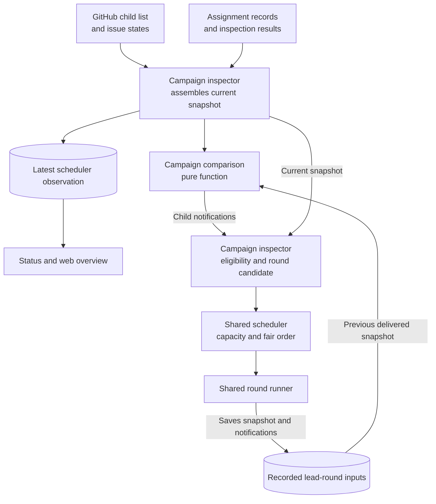

# Design for campaigns

## What we're building

A campaign commissions a lead to carry a parent issue's sub-issues
through their ordinary assignments. The lead uses `dream:lead` to
review, coordinate and merge through GitHub. The daemon decides when the
lead has something to consider. The user alone closes the parent issue.

This design follows the [requirements](requirements.md) and the code in
the [reading guide](reading-guide.md). It adds a third kind of agent
work while retaining the shared work records, round runner, capacity and
recovery rules.

## How it works

### One campaign through the system

The user assigns the parent issue to themselves and applies a campaign
label. At an update, the daemon discovers the request and reads its
children. The campaign needs no comment to start. When a slot is
available, it records the work, prepares a detached worktree from main,
saves the initial input, and starts the lead.

The lead reads the plan on GitHub. It labels and assigns open children
where needed, preserving labels the user already chose. It chooses among
the daemon's configured assignment routes and asks on the parent when
the choice or the plan is unclear. The dependency chain controls which
assignment starts. Starting an assignment does not wake the lead.

A child finishes its turn. At the next update, the ordinary assignment
inspection establishes whether another round is due. When none is
running or due, the campaign compares the child's current facts with the
snapshot in the previous delivered lead input. A relevant difference
makes a lead round due. If capacity is unavailable, a later update
repeats the comparison.

The lead's next input gives the whole current picture and highlights why
it was woken. The lead reads the pull request, runs the stage's proof,
and posts feedback or merges when satisfied. Feedback uses the existing
assignment relay. A merge closes the child issue, allowing the next
stage to start. The previous assignment can still be taking its wrap-up
round.

The user may intervene, pause the lead, add children or end the
campaign. These actions leave child assignments governed by their
ordinary rules.

### Work, routes and lifetime

Add `campaign` to `AgentWorkKind` and a campaign route list to the
configuration. Label identities remain unique across all kinds. The
default `dream:lead` route supplies recipes for both harnesses, using
the same capable defaults as the existing general assignment route.

Reuse `AgentWorkRecord`, its identifier convention, the saved harness
session, round directories, retry request and ending. No campaign branch
or pull request is created. Its channel is the parent issue.

Use the conversation's label-based identity and lifetime rules. A
campaign belongs to its starting label; removing that label or the
user's assignment pauses new rounds. Another configured campaign label
on the issue is a routing conflict. A running round finishes. Restoring
eligibility resumes the same campaign and session. Changing to another
label follows the existing conversation convention of retaining the old
work paused and starting new work under the new label.

Parent closure ends the campaign once no round is running, before
considering fault or further input. No wrap-up round is required merely
to record that ending. A reopened parent can receive a new campaign.
Only the user closes the parent; waiting for a decision does not remove
the campaign label.

### Observing the children

Add a paginated GitHub read for
`repos/{repository}/issues/{parent}/sub_issues`. It returns the direct
children with their issue numbers, titles, states, labels and assignees.
Normalise the REST fields through the GitHub projection boundary. The
GitHub relationship is authoritative; no separate campaign ownership
file is introduced.

Keep the work already read at the start of an update available for
lookup, including ended assignments. Match each child to its newest
local assignment by issue number. Retain ordinary assignment inspections
and new-request findings for that same update. An ended assignment
remains visible as ended, rather than appearing to have vanished.

The snapshot contains presentation context and the small set of facts
used for notification. Comparison matches children by issue number, so
incidental list order is not a change.

| Fact                                                                                             | Purpose                                                                                                      |
| ------------------------------------------------------------------------------------------------ | ------------------------------------------------------------------------------------------------------------ |
| The child issue's number, title and state identify it and describe its progress.                 | Membership and issue-state changes can require coordination.                                                 |
| The latest assignment identifier and pull-request reference locate its work.                     | Replacement assignments remain distinguishable when round numbering restarts.                                |
| The last round that took its turn identifies its latest handback.                                | Successful and stopped rounds count; errored and interrupted rounds do not.                                  |
| Whether the child is settled records whether it has a round running or due.                      | A transition to settled remains visible even if the lead received an intervening snapshot while it was busy. |
| The pull request's state, draft flag, merge status and observed head describe the reviewed work. | Changes can require review or a different response to the stage.                                             |
| The check result and whether any checks are still running describe the checks at that head.      | A failing aggregate alone cannot show when the final check finishes.                                         |
| The assignment's ending and fault describe termination or a need for intervention.               | These are local facts and remain available when no pull-request inspection runs.                             |

A startable assignment request counts as work due even before the work
record exists. An ended assignment has no new round due, though a
running round still counts while cancellation is stopping it. A child
with neither work nor a startable request has no assignment round to
wait for.

Use the existing assignment inspection's observations. Extend its
`PullRequestFinding` to retain the observed head and whether any checks
are running, calculated from the individual checks already read. Do not
query a pull request again just for campaign inspection. Reuse the merge
status that the inspection already retains. When fault or ending means
no fresh inspection exists, retain the reference and available local
facts without pretending to have current checks. The lead can read
GitHub itself.

Cancellation notifies the lead once the child's running round has
stopped. The lead can investigate and ask the user on the parent how to
proceed. Do not continue monitoring the cancelled assignment's pull
request; subsequent parent comments and child issue closure remain
observable.

### Comparing snapshots and producing notifications

Use the newest lead input that counts as delivered under
`AgentWork.list_relayed_round_paths`. It supplies one previous snapshot
for the whole campaign. Do not scan older inputs separately for each
child.

Each update compares that snapshot with the current observation and
selects the notifiable differences. No notification object waits between
updates. Only a round that actually starts records a new input.

#### Notification types

A notification identifies a change that may require the lead to act.
Child notifications come from the snapshot comparison; parent comments
come from the existing comment relay. These names describe the reasons
shown to the lead, without introducing another delivery mechanism.

| Name                          | Change and notification rule                                                                                                                                                                                                                          |
| ----------------------------- | ----------------------------------------------------------------------------------------------------------------------------------------------------------------------------------------------------------------------------------------------------- |
| Parent comment                | A new eligible comment arrives on the parent. Child activity does not defer it.                                                                                                                                                                       |
| Child membership change       | A child was added or removed. Notify independently of whether other children are working.                                                                                                                                                             |
| Child issue state change      | A child issue was closed or reopened. Notify when that child has no assignment round running or due.                                                                                                                                                  |
| Assignment handback           | The child is settled and its assignment, finished turn or settled state differs from the previous snapshot.                                                                                                                                           |
| Pull-request change           | The pull request's draft flag, head or open/closed/merged state changed. Notify when the child is settled and the observation is known.                                                                                                               |
| Check completion              | Checks finished, or a finished result changed. Notify when the child is settled and its known checks have no run still pending. Compare the head, result and running-check flag.                                                                      |
| Pull request became mergeable | The previous snapshot's merge status was outside `CLEAN`, `HAS_HOOKS` and `UNSTABLE`, and the current status is in that set. Notify when the child is settled, even if its head and checks have not changed. The lead still decides whether to merge. |
| Assignment ending             | The assignment ended. Notify once it has no running round.                                                                                                                                                                                            |
| Assignment fault              | The assignment entered fault. Notify once it has no running round.                                                                                                                                                                                    |

The types can overlap. One observation can report a merged pull request,
a closed child issue and an ended assignment. Those are different facts
in one input, not a reason to launch three rounds. Each child
notification identifies the affected child and the relevant changed
facts. The whole current snapshot accompanies them.

Moving between `CLEAN`, `HAS_HOOKS` and `UNSTABLE` does not itself
notify again. Changed check results have their own notification. These
states follow GitHub's meaning of mergeable; they do not replace the
lead's review or the repository's merge restrictions.

Starting a campaign and recovering an unfinished lead round are also
reasons to run the lead, but neither requires a notification. All launch
reasons remain subject to the campaign's eligibility, fault, read,
capacity and cooldown rules.

The assignment identifier appearing for the first time does not itself
generate a notification while work is running or due. Feed output,
elapsed time, main moving and ordinary check progress do not wake the
lead. A change back to the previously delivered facts needs no separate
event history.

For example, the lead can receive a snapshot while a child is still
working on round 4. When it later settles, the finished turn and settled
flag make that handback visible. If round 3 finished but round 4 was
immediately due, round 3 needed no separate notification.

Several differences produce one batch. The lead sees current facts and
their relevant differences, not a replay of every intermediate state.
Changes after the launching update's observations remain available to
later comparisons.

#### Example from assignment work to merge

Checks finishing and GitHub resolving mergeability can be observed in
separate updates. This example chooses checks finishing first. It
assumes the lead finishes each round before the next change is observed,
and no pause, fault or capacity limit prevents launch.

| Step | Observed change                                                                                                        | Lead notification and possible response                                                                                                                                   |
| ---- | ---------------------------------------------------------------------------------------------------------------------- | ------------------------------------------------------------------------------------------------------------------------------------------------------------------------- |
| 1    | The child agent is working on a draft pull request.                                                                    | There is no notification.                                                                                                                                                 |
| 2    | The agent pushes changes and marks the pull request ready. Checks run while the agent continues working.               | There is no notification while the child is working.                                                                                                                      |
| 3    | The child finishes its turn and has no further round due. Checks still run and merge status is `UNKNOWN`.              | Assignment handback wakes the lead. It can review the work, then end its turn while waiting. Other notifiable differences from the previous input accompany the handback. |
| 4    | All checks finish and pass. Merge status remains `UNKNOWN`.                                                            | Check completion wakes the lead. It sees the successful result but may still need to wait before merging.                                                                 |
| 5    | Merge status changes from `UNKNOWN` to `CLEAN`. The commit and check results are unchanged.                            | Pull request became mergeable wakes the lead. It can finish its assessment and merge.                                                                                     |
| 6    | The lead merges the pull request. The child issue closes, and the child assignment has a wrap-up round running or due. | The affected child's notifications wait until it settles.                                                                                                                 |
| 7    | The child finishes wrapping up and its assignment ends.                                                                | Assignment ending and child issue state change notify the lead. The input includes the current picture of the other children.                                             |

If steps 4 and 5 are both observed before the next lead round starts,
that input contains both reasons. They do not require separate rounds.
If checks fail and ordinary assignment handling makes another child
round due, the lead waits for the child to settle or enter fault.

GitHub's
[merge-status definitions](https://docs.github.com/en/enterprise-cloud%40latest/graphql/reference/pulls#mergestatestatus)
distinguish mergeability from passing checks: `UNSTABLE` is mergeable
with non-passing status, while `CLEAN` includes passing status. GitHub
can also
[calculate mergeability in the background](https://docs.github.com/en/rest/pulls/pulls#get-a-pull-request).
The example illustrates separate observations, not a fixed GitHub
lifecycle that every pull request must follow.

#### Example with a CI repair round

This example starts with an open, non-draft pull request. The first
child turn has finished, checks are still running, and the lead has
already received the handback. Ordinary assignment inspection runs
before campaign inspection, so a due repair round makes the child
unsettled even before that round can obtain capacity.

| Step | Observed change                                                                                                   | Lead notification and possible response                                                                                                         |
| ---- | ----------------------------------------------------------------------------------------------------------------- | ----------------------------------------------------------------------------------------------------------------------------------------------- |
| 1    | A check fails. Assignment inspection finds a new check-failure signal and makes a repair round due.               | The failure does not notify the lead because the child has work due. This also applies if other checks are still running.                       |
| 2    | The child agent starts the repair round.                                                                          | Starting the round produces no notification.                                                                                                    |
| 3    | The agent fixes the failure and pushes a new commit. Checks run on that commit while the agent continues working. | The changed head does not notify the lead while the child is working.                                                                           |
| 4    | The repair turn finishes, and no further child round is due. Checks still run.                                    | Assignment handback and pull-request change notify the lead together. It can review the revised work and end its turn while waiting for checks. |
| 5    | Checks finish and pass. Merge status remains `UNKNOWN`.                                                           | Check completion notifies the lead.                                                                                                             |
| 6    | Merge status becomes `CLEAN` with no further commit or check change.                                              | Pull request became mergeable notifies the lead. It can finish its assessment and merge.                                                        |
| 7    | The merged child's wrap-up finishes and its assignment ends.                                                      | Assignment ending and child issue state change notify the lead, as in the preceding example.                                                    |

The intermediate failure is not queued for later delivery. At handback,
the lead receives the current snapshot and its notifiable differences
from the previous delivered input. If checks have already passed when
the repair turn finishes, the handback, changed head and check
completion can accompany the same lead round.

If another repair round is immediately due, there is no intervening
handback notification. Existing assignment rules limit automatic
check-failure follow-ups to two consecutive attempts. If that limit
withholds another failure signal, the child can settle with failing
checks and notify the lead of its handback and current result. Failing
CI alone does not put an assignment in fault; fault follows the existing
rules for errored agent rounds.

#### Example with lead-requested changes

The lead is reviewing a settled child after receiving its handback.
Feedback on the child's pull request uses the existing assignment relay.

| Step | Observed change                                                                                                      | Lead notification and possible response                                                                                          |
| ---- | -------------------------------------------------------------------------------------------------------------------- | -------------------------------------------------------------------------------------------------------------------------------- |
| 1    | The lead finds a missing proof or asks a question. It comments on the child's pull request without the agent marker. | Posting feedback creates no separate lead notification.                                                                          |
| 2    | Ordinary assignment inspection reads the eligible comment and makes a child round due.                               | The child is no longer settled, so this does not notify the lead.                                                                |
| 3    | The child starts its response round. The lead ends its own turn while waiting.                                       | Starting the child round produces no notification. The child can start before the lead's current round ends if capacity permits. |
| 4    | The child makes corrections, pushes a commit and answers on the pull request.                                        | No child notification wakes the lead while that child round is running.                                                          |
| 5    | The child finishes its response turn and no further round is due.                                                    | Assignment handback notifies the lead. A changed head and any other notifiable differences accompany it in the same input.       |
| 6    | The lead reads the response and checks the proof against the current work.                                           | It can accept the correction, ask for another change or wait for checks and mergeability. Those follow the preceding examples.   |

A response that explains the existing work without changing code still
produces a handback: the finished turn differs from the previous lead
input. If the child finishes while the lead's earlier round is still
running, the shared runner prevents a second simultaneous lead round;
the next comparison can still find that handback. No separate
notification for the child's reply text is needed, because the lead can
read the pull request when it receives the handback.

#### Example with a parent comment during child work

A parent comment can start a lead round while a child is working. That
round receives the full current picture, including the child's unsettled
state. The later handback must remain visible even when the
parent-comment round has already shown the lead the child's latest
commit.

| Step | Observed change                                                                      | Lead notification and comparison                                                                                          |
| ---- | ------------------------------------------------------------------------------------ | ------------------------------------------------------------------------------------------------------------------------- |
| 1    | The child is working on another round.                                               | Starting that round does not notify the lead.                                                                             |
| 2    | The user posts an eligible parent comment.                                           | Parent comment wakes the lead. Its input records that the child is unsettled and identifies the last finished child turn. |
| 3    | The lead answers the parent comment and finishes while the child keeps working.      | This delivered input becomes the comparison point. It records no handback for the running child turn.                     |
| 4    | The child finishes its turn, with no further round due and no further commit change. | Assignment handback notifies the lead because the finished turn and settled state differ from the parent-comment input.   |
| 5    | The lead receives that handback and the current snapshot.                            | Further unchanged observations produce no notification.                                                                   |

If the child finishes while the parent-comment round is still running,
the next lead round waits for that round to finish. Its comparison still
uses the snapshot that was delivered, which recorded the child as
unsettled. There is no queued handback to consume prematurely: the
handback becomes notifiable when the child settles.

#### Example with interruption after a merge

The lead can complete a GitHub action before its round is interrupted.
Recovery follows the existing session and delivery rules; replaying
input does not mean repeating completed actions.

| Step | Observed change                                                                                    | Lead scheduling and response                                                                                                                                                             |
| ---- | -------------------------------------------------------------------------------------------------- | ---------------------------------------------------------------------------------------------------------------------------------------------------------------------------------------- |
| 1    | A lead round reviews a settled child and successfully merges its pull request.                     | The merge is an action within that lead round.                                                                                                                                           |
| 2    | The lead round is interrupted before it finishes.                                                  | Its input does not advance delivery. The successful merge remains in GitHub.                                                                                                             |
| 3    | On recovery, ordinary inspection sees the merged child and may make its wrap-up round due.         | The unfinished lead round independently makes recovery due, even if the child is unsettled and produces no notification. Campaign eligibility, reads, capacity and cooldown still apply. |
| 4    | The lead resumes its saved harness session with fresh observations and an unfinished-round prompt. | It retains the earlier session's actions. If the merge outcome is uncertain, it checks GitHub before acting. It continues from the current state rather than issuing the merge again.    |
| 5    | The recovery round finishes.                                                                       | Its input becomes the comparison point for later child notifications and parent comments.                                                                                                |

The recovery input compares current facts with the previous delivered
input, excluding the interrupted attempt. Some highlighted differences
may therefore concern work the resumed lead already handled. The lead's
session and current GitHub state establish which actions remain. No new
notification type or separate action journal is required.

Changes that occur after the interrupted round starts and before
recovery starts are included in that same comparison. For example, if
another child hands back and a new child is added during that interval,
the recovery input reports both changes. Every lead round receives the
current snapshot and its notifiable differences from the previous
delivered snapshot. Recovery additionally asks the lead to finish any
unfinished work from the preceding attempt. The first round has no
previous snapshot and receives the initial picture.

#### Example with changes while the lead cannot start

Pausing the lead and exhausting capacity both prevent a new input from
being delivered. Each update still gathers the current campaign picture
and compares it with the last delivered input. This example pauses an
idle lead whose previous input showed child A working and child C open.

| Step | Observed change                                                                   | Lead scheduling and notifications                                                                                                                                         |
| ---- | --------------------------------------------------------------------------------- | ------------------------------------------------------------------------------------------------------------------------------------------------------------------------- |
| 1    | The user removes the campaign label.                                              | No new lead round can start. The previous input remains the comparison point.                                                                                             |
| 2    | Child A finishes its turn, then its checks pass and merge status becomes `CLEAN`. | Those facts are visible in current observations, but no lead input is delivered while paused. Child assignments continue under their ordinary rules.                      |
| 3    | The user adds child B.                                                            | The current child list includes B. The comparison point still does not advance.                                                                                           |
| 4    | Child C closes and then reopens before any lead round starts.                     | Its current state again agrees with the previous input, so that temporary change produces no issue-state notification.                                                    |
| 5    | The user restores the campaign label and capacity is available.                   | One lead round receives the current snapshot, A's handback, check completion and mergeability changes, and B's addition. Any other notifiable differences accompany them. |

Capacity delays work the same way. An observation that finds no free
slot does not freeze a future input or advance delivery. The update that
launches the round supplies the snapshot and notifications. No replay of
temporary states is required. If the current facts have returned to the
previous delivered picture and no other launch reason remains, no lead
round is due merely because the label was restored or capacity became
available.

### Parent comments and round input

Reuse the existing eligible-comment rule on the parent. Only the
signed-in user's speaking, unmarked comments count. The lead remains
free to read GitHub at any time; the saved comments identify the user's
new input rather than restricting what it may inspect.

Each campaign input contains the parent reference, the current child
snapshot, the highlighted changes, the new eligible parent comments, the
parent comment position reached, the checked-out main revision, and the
daemon's active assignment routes with their recipes. The comment
position is carried forward when a child-only round contains no new
parent comments, so the previous delivered input is sufficient for the
next comparison. It is part of the round input, not a separate cursor
file.

Supplying active routes matters because the daemon's startup
configuration may differ from the file now on main. Existing campaign
settings stay frozen in its work record; the available choices for child
assignments come from the current daemon.

A new campaign, an unfinished lead round, new parent comments, or a
notifiable child change can make a round due. Pause, fault, read
failure, capacity and cooldown apply before launch. An unfinished lead
round can recover even if its earlier actions have left no new child
notification.

### Recovery and failed reads

Recovery resumes the existing harness session when available. The lead
keeps its knowledge of actions completed in the earlier attempt and
continues from there. Errored and interrupted inputs do not advance
delivery; successful, stopped and running inputs do. A stopped lead
waits for new input instead of automatically repeating the stopped
round.

The new input is recomputed from current observations against the
previous delivered input. A recovery prompt says the previous round did
not finish. The lead checks current GitHub state where an earlier
action's outcome is uncertain or where a new decision depends on it.
This does not require a separate action journal.

If a GitHub read needed for the snapshot fails, report the failure and
start no lead round from that incomplete picture. Do not treat missing
data as a removed child or a state transition. The next update retries,
leaving the comparison point unchanged. This deliberately allows one
unreadable child to delay the lead, including a reply to a parent
comment. Other assignments continue under their own inspections. Not
having a fresh pull-request read because an assignment is in fault or
ended is not itself a read failure.

Campaigns share fault and cooldown rules. A user retry clears the fault
by recording a timestamp. The lead investigates a child's fault, posts
useful directions on the child's pull request when possible, and reports
the problem and proposed resolution on the parent. The user handles the
retry.

### Scheduling and code ownership

Keep one scheduler and two inspection passes. Inspect ordinary
assignments and conversations, including new requests, first. Inspect
campaigns second, passing the ordinary observations and the latest
assignments by issue. The campaign pass does not consume status reports
or invoke the child agents.

The diagram shows the child-observation path. Arrows represent data
flow. Parent comments and recovery can also make a lead round due,
through the same campaign inspector and shared scheduler.

The overview reads the latest observation even while the lead is paused.
Comparison reads the previous delivered round input, selected by the
campaign's input reader. The two records use the same snapshot type but
serve different purposes.

Launch after inspection, using a cycle of assignment, conversation and
campaign. Skip kinds with no candidate. Preserve
existing-work-before-new-work ordering within each kind, and advance the
cycle on a failed launch as today. Inspection order therefore does not
give assignments strict launch priority over campaigns.

Campaign snapshot, notification and round-input models, the
previous-input reader, snapshot comparison and workspace preparation
belong in a campaign module alongside `agent_assignments.py` and
`issue_conversations.py`. Campaign eligibility, snapshot assembly and
round composition belong in `scheduler/campaigns.py`.

The campaign inspector combines the parent's child list with the latest
assignment records and ordinary inspection results. Ordinary assignment
inspection remains the authority on whether another child round is due,
before capacity is considered. Campaign inspection uses that result and
whether a round is running to determine whether the child is settled; it
does not repeat the assignment's scheduling rules. A failed read remains
unknown and prevents an incomplete lead input, rather than counting as
no work due.

Snapshot comparison is a pure function of the current and previous
delivered snapshots. It returns notifications without reading files,
calling GitHub or launching work. The scheduler imports the campaign
types; the campaign module does not import scheduler types or consume
inspection candidates.

The campaign inspector supplies an ordinary candidate when a round is
due. Its composer produces the existing `RoundPlan`, including the
preparation and input prompt. The shared scheduler applies capacity and
scheduling order, then the existing runner prepares the workspace,
records the input, starts or resumes the harness and records the
outcome. The runner does not interpret child snapshots or notifications.
Recovery uses the same handoff: campaign composition supplies fresh
input, and shared prompt composition identifies the previous unfinished
round.

Keep GitHub reads in `github.py` and persisted scheduler observations in
`scheduler/models.py`. Status consumes those observations through its
existing read-only boundary. The scheduler observation holds the latest
campaign picture for the overview, including while the lead is paused.
The round input holds the snapshot and notifications actually delivered
to the lead and supplies the comparison point for later rounds. Both use
the campaign module's snapshot type. Do not add a separate mutable
last-snapshot file or notification queue.

Keep separate conversation and campaign inspectors, sharing the small
decision about whether the issue's labels and assignment permit new
rounds. A paused conversation can stop reading further input; a paused
campaign still needs current child membership for its overview. Both
kinds reuse the detached-worktree refresh in `git.py`, while retaining
their own input preparation and publication behaviour. No workflow
framework or new round runner is required.

Update the places that assume two kinds explicitly: configuration,
setup, request inspection, scheduling alternation, prompt selection,
harness permissions, round descriptions, commands and both
presentations. Extend stop, retry, feed and detail selection to
campaigns. Cancellation remains an assignment control; campaigns end
through parent closure.

### Workspace, messages and merge judgment

Reuse the detached-worktree refresh before each lead round. During
review, the lead may fetch and check out a child pull-request commit in
detached mode and run its proof. It does not take over the child's
branch or commit implementation changes. It asks the child to make
corrections on the stage pull request. The refreshed workspace and
resumed session serve the same distinct roles as they do for
conversations.

The lead publishes its own messages. No finishing function automatically
posts its final answer on the parent; final output remains in the feed.
There is no separate continuing campaign record or routine parent action
log.

Campaign prompts omit the agent marker on feedback posted to child pull
requests, allowing the existing assignment relay to deliver it as user
feedback. Posts elsewhere, including the parent, keep the marker.
Existing assignment and conversation prompts retain their current marker
rule. The lead respects the user's interventions and asks on the parent
before changing requirements, settled design or roadmap stages and
dependencies.

The `dream:lead` skill owns review judgment and GitHub coordination. It
checks the stage's proof against its completion conditions, considers
relevant changes on main, and gets specification corrections made before
merging. It reviews the current pull-request head and takes new user
feedback into account. It respects the repository's merge restrictions.
On a repository requiring branches to be current, the existing
assignment machinery handles the out-of-date signal. The lead ends its
turn when waiting for work or checks; it does not poll main or restart
reviews for every unrelated commit.

Give campaigns explicit harness permissions for the required GitHub
review, merge, issue-editing and comment operations, and for fetching
and checking out commits to verify them. Configure these in the
adapters, where this repository already owns unattended permissions,
rather than trying to set reserved permission keys through recipe
config. Keep the existing assignment and conversation permission
behaviours intact.

### Status and the web overview

Each open campaign's scheduler observation records its current child
list, issue states and work references, alongside what explains its
eligibility or pause. While the lead is paused, continue reading the
parent's child list and issue states to detect membership changes,
include children without assignments and update the closed/total count.
Reuse the ordinary assignment observations for child cards; do not read
their pull requests again for this purpose. These reads keep the
overview current, rather than preserving a notification history. The
latest update, not the last lead input, feeds the live campaign display.

Status derives the lead's ordinary work status and combines child
membership with existing assignment and request statuses. Count closed
GitHub issues, not completed or cancelled assignments. Every child
appears, including one with no saved assignment or no dispatch request
yet. Failure to read the campaign picture is reported as unknown, not as
an empty campaign.

The web interface adds a Campaigns tab. Each active campaign shows its
lead summary, the closed/total count and an expandable child overview.
Use existing assignment summaries and request information; do not
rederive lifecycle rules in web code. Child assignments remain in the
Assignments tab too.

Give each displayed appearance its own HTML identifier. Keep the lead
card and the expandable child block as siblings within a campaign
wrapper, so the existing card-output reader does not mistake a child's
output for the lead's. Preserve expansion through the existing
details-refresh behaviour.

An ended campaign appears in the ordinary expandable ended section with
its summary and parent link. It has no nested child cards and needs no
archived child snapshot. Individual assignments remain visible under
their own rules.

## What changes, and what goes away

- Add campaign routes, work kind, input and observation models,
  inspection, status and views, and the corresponding command selectors.
- Add the sub-issue GitHub read and retain the head and running-check
  information already available in assignment inspections.
- Replace two-kind scheduling choices with explicit three-kind handling
  and fair alternation. Share the existing issue-lifetime mechanics
  where they agree.
- Add `dream:lead` in the dream plugin and a campaign section to the
  agent contract. The daemon owns dispatch and delivery; the skill owns
  judgment.
- Remove assignment-start notifications from the requirements. They
  create no routine action for the lead and would spend rounds on
  information alone.
- Remove child cards from ended campaigns. This removes the need to
  preserve a final campaign snapshot purely for an infrequently used
  historical view.
- Update the ontology, stories, architecture, configuration and command
  references, contract, compatibility page and changelog with
  implementation.

Use state format 7 and a major release. Older versions would reject
campaign records in the shared v6 directory. A separate format isolates
the new records and leaves old state untouched; no migration is
introduced. Users finish or take over old assignments and accept fresh
conversations before upgrading, following the existing policy. The
shared daemon lock remains outside the format directory.

Keep agent contract version 1. Adding a campaign contract does not
require existing conforming assignment or conversation skills to change.
Coordinate the dream plugin release so the default route can invoke
`dream:lead`.

The implementation needs behaviour tests for notification filtering and
coalescing, busy-to-settled comparisons, changes during lead rounds,
recovery, pausing and ending, failed reads, fault/cooldown and
three-kind capacity. Exercise both harnesses' prompts and permissions.
Regenerate affected view goldens and check nested cards, unique
identifiers, unstarted children and expansion across refresh in the
browser. Retain full branch coverage and the repository's existing
checks.

## Why it's this and not something else

Periodic lead wake-ups would save comparison code but repeatedly spend
agent rounds discovering that nothing needs action. A separate
notification queue would preserve intermediate transitions that the lead
does not need, and would add delivery state and recovery work.

One full snapshot per delivered lead input is sufficient. Including
whether each child has settled avoids a separate history lookup for
every child. The latest snapshot supplies the comparison point; GitHub
and the resumed session supply the collaboration context.

Strict assignment launch priority could starve leads behind unrelated
work. The existing alternation model extends without that cost. A
campaign branch would change the established stage-to-main workflow and
defer integration; ordinary child assignments and GitHub dependencies
already provide it.

## What's still open

No design decisions remain open.
